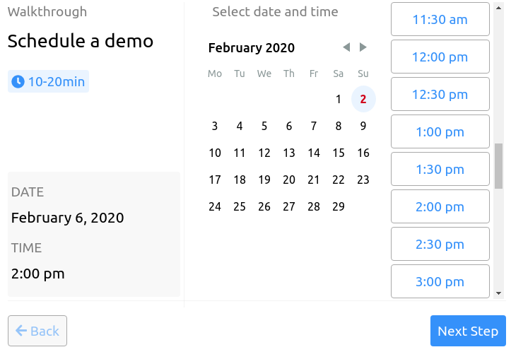
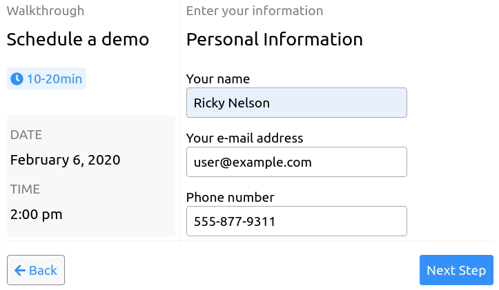
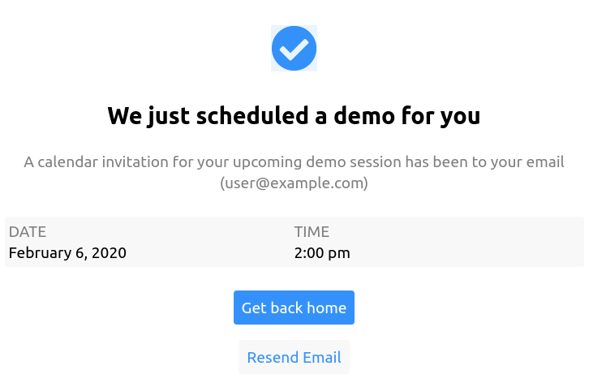

# Schedule Event

A React-based 3-step wizard demo for scheduling appointments. Users select a date, time, and enter contact information.

**[Live Demo](https://zolmok.github.io/schedule-event/)**

## Inspiration

I ran across an interesting UI that I wanted to try and replicate with React: [Schedule Demo Exploration](https://dribbble.com/shots/9357635-Schedule-Demo-Exploration). My goal was to learn how React hooks worked as well as just do something fun.

I've written a blog post about my efforts you can read [here](https://zolmok.org/posts/portfolio-schedule-event/) if you're interested.

---

<p align="center">
  
</p>

---

<p align="center">
  
</p>

---

<p align="center">
  
</p>

---

## Tech Stack

- React 18
- Redux Toolkit with React-Redux
- Vite for development and builds
- Vitest + React Testing Library for testing
- react-day-picker for calendar
- Day.js for date handling
- FontAwesome icons

## Commands

```bash
npm install           # Install dependencies
npm start             # Development server (localhost:5173)
npm run dev           # Development server (alias)
npm test              # Run tests (watch mode)
npm test -- --run     # Run tests once
npm run test:coverage # Run tests with coverage
npm run build         # Production build
npm run preview       # Preview production build
npm run lint          # Lint code
npm run deploy        # Deploy to GitHub Pages
```

## Project Structure

This is a 3-step wizard flow:

1. **Date & Time Selection** - Pick a date from the calendar and select a time slot
2. **Contact Information** - Enter your contact details
3. **Confirmation** - Review and confirm the appointment

### Key Components

- `schedule-wizard/` - Main orchestrator managing the 3-step flow
- `every-day-calendar/` - Date picker using react-day-picker
- `time-picker/` - 24-hour time selection (30-min intervals)
- `contact-form/` - User contact information form
- `date-scheduled/` - Left panel showing selected date/time
- `demo-complete/` - Confirmation screen
